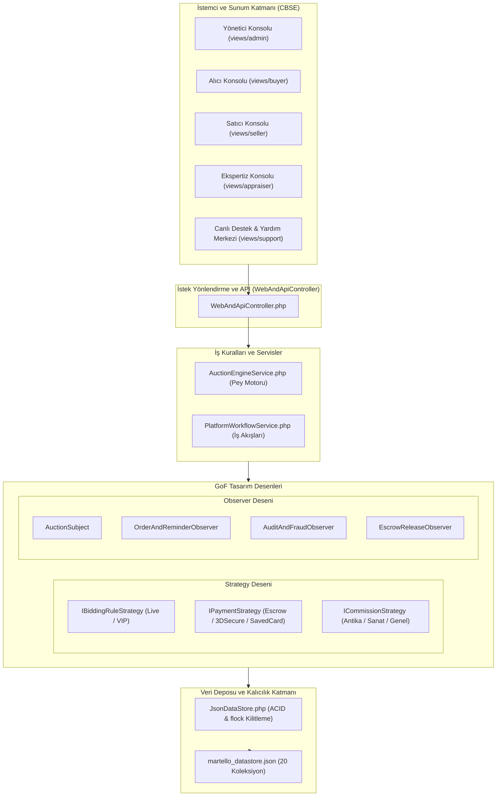

# MARTELLO Çevrimiçi Müzayede ve Ekspertiz Platformu
# Proje Geliştirme Günlüğü, Gereksinim İzleme ve Talep Geçmişi

**Proje:** MARTELLO Çevrimiçi Müzayede ve Ekspertiz Platformu  
**Standart Uyumu:** IEEE Std 830-1998 & ISO/IEC/IEEE 29148:2018 (SRS)  
**Mimari:** Pure Native PHP 8.2+, JSON DataStore, GoF Tasarım Desenleri (Observer & Strategy), 5 Rol RBAC  
**Ekip:** ZeroDay Ekibi — Gümüşhane Üniversitesi Yazılım Mühendisliği  
**Tarih:** 21 Kasım 2026  

---

## 📑 İçindekiler Tablosu

1. [Yönetici Özeti ve Genel Mimari](#1-yönetici-özeti-ve-genel-mimari)
2. [Geliştirme Talepleri ve Teknik Uygulama Geçmişi](#2-geliştirme-talepleri-ve-teknik-uygulama-geçmişi)
   - [Talep 1: Platform Komisyon Oranları ve Sabit Hizmet Bedelleri](#talep-1-platform-komisyon-oranları-ve-sabit-hizmet-bedelleri)
   - [Talep 2: Komisyon Yönetim Kartlarının Üst Bölüme Taşınması](#talep-2-komisyon-yönetim-kartlarının-üst-bölüme-taşınması)
   - [Talep 3: Teklif Anında Pey Teminatı Blokesi ve Emanet Havuzu](#talep-3-teklif-anında-pey-teminatı-blokesi-ve-emanet-havuzu)
   - [Talep 4: Bloke Tutarlarının Otomatik İadesi (İptal, Geçersizlik ve İhtilaf)](#talep-4-bloke-tutarlarının-otomatik-iadesi-iptal-geçersizlik-ve-ihtilaf)
   - [Talep 5: Zaman Damgalı Denetim Günlükleri (Audit Trail)](#talep-5-zaman-damgalı-denetim-günlükleri-audit-trail)
   - [Talep 6: Denetim Günlüğü Masasının Üst Bölüme Taşınması](#talep-6-denetim-günlüğü-masasının-üst-bölüme-taşınması)
   - [Talep 7: Kapsamlı Yardım Merkezi Modülü (Kurallar, Rehber, SSS, Bilet ve Canlı Destek)](#talep-7-kapsamlı-yardım-merkezi-modülü-kurallar-rehber-sss-bilet-ve-canlı-destek)
   - [Talep 8: Yardım Merkezi Arayüzünün Kurumsal Standartlara Göre Yenilenmesi](#talep-8-yardım-merkezi-arayüzünün-kurumsal-standartlara-göre-yenilenmesi)
   - [Talep 9: Kredi Kartı, Banka Kartı ve Kayıtlı Kartlarla 3D Secure Ödeme Entegrasyonu](#talep-9-kredi-kartı-banka-kartı-ve-kayıtlı-kartlarla-3d-secure-ödeme-entegrasyonu)
   - [Talep 10: Açık Artırma Süresi Dolduğunda Kazanan ve Satıcı Bilgileriyle Benzersiz Sipariş Üretimi](#talep-10-açık-artırma-süresi-dolduğunda-kazanan-ve-satıcı-bilgileriyle-benzersiz-sipariş-üretimi)
   - [Talep 11: Çalışmanın Kesintisiz Devam Ettirilmesi ve Entegrasyon](#talep-11-çalışmanın-kesintisiz-devam-ettirilmesi-ve-entegrasyon)
   - [Talep 12: Benzersiz Sipariş Özelliğinin Mimari Konumu](#talep-12-benzersiz-sipariş-özelliğinin-mimari-konumu)
   - [Talep 13: Ürün Bazlı Açık Artırma Süreci (Başlangıç/Bitiş) ve Teklif Adımı Büyüklüğü Arayüzü](#talep-13-ürün-bazlı-açık-artırma-süreci-başlangıçbitiş-ve-teklif-adımı-büyüklüğü-arayüzü)
   - [Talep 14: Başka Bilgisayarda Sıfır Konfigürasyonla Çalıştırma Çözümleri](#talep-14-başka-bilgisayarda-sıfır-konfigürasyonla-çalıştırma-çözümleri)
   - [Talep 15: Taşınabilir Dağıtım Paketinin Dosya Yolu ve Erişimi](#talep-15-taşınabilir-dağıtım-paketinin-dosya-yolu-ve-erişimi)
   - [Talep 16: GitHub Deposu ile Senkronizasyon Durumu](#talep-16-github-deposu-ile-senkronizasyon-durumu)
3. [Tasarım Desenleri ve Mimari Haritası](#3-tasarım-desenleri-ve-mimari-haritası)
4. [Sistem Giriş Bilgileri ve Rol Matrisi](#4-sistem-giriş-bilgileri-ve-rol-matrisi)

---

## 1. Yönetici Özeti ve Genel Mimari

MARTELLO Çevrimiçi Müzayede ve Ekspertiz Platformu; sanat, antika, nümismatik ve nadir koleksiyon eserlerinin güvenli, şeffaf ve denetlenebilir açık artırmalarla el değiştirmesini sağlayan kurumsal bir web yazılımıdır.

Platformun temel mimari prensipleri şunlardır:
1. **Harici Veritabanı Bağımsızlığı:** MySQL veya harici ilişkisel DB kurulumuna gerek duyulmaksızın, ACID transaction ve pesimistik kilitleme (`flock`) destekli yerleşik JSON Veri Deposu (`storage/martello_datastore.json`) kullanılmaktadır.
2. **GoF Tasarım Desenleri:**
   - **Observer Deseni:** Açık artırma süresi dolumu, yeni pey sürülmesi, emanet blokesi ve sipariş üretiminde 7 somut gözlemci otomatik olarak tetiklenir.
   - **Strategy Deseni:** Teklif kuralları (`LiveAuctionStrategy`, `VipAuctionStrategy`), ödeme yöntemleri (`EscrowWalletStrategy`, `ThreeDSecurePosStrategy`, `SavedCardStrategy`) ve komisyon hesaplama dinamik strateji sınıflarıyla yürütülür.
3. **Rol Tabanlı Erişim Denetimi (RBAC):** Sistemde 5 ayrı rol (Yönetici, Alıcı, Satıcı, Ekspertiz Uzmanı, Canlı Destek) bağımsız yetki matrisleriyle donatılmıştır.

---

## 2. Geliştirme Talepleri ve Teknik Uygulama Geçmişi

Aşağıda proje boyunca iletilen tüm geliştirme talepleri; **profesyonel kurumsal üsluba dönüştürülmüş ifade**, **ilgili SRS maddesi**, **yapılan teknik mühendislik çalışmaları** ve **etkilenen dosyalar** ile detaylandırılmıştır.

---

### Talep 1: Platform Komisyon Oranları ve Sabit Hizmet Bedelleri

* **Kullanıcı Talebi:**  
  *"Platformumuzda müzayedelerden, başarılı satış işlemlerinden ve ekspertiz hizmetlerinden tahsil edilecek platform komisyon oranları ile sabit hizmet bedellerinin parametrik olarak tanımlanmasını ve yönetici panelinden yapılandırılabilmesini talep ediyorum."*  
* **İlgili SRS Maddesi:** SRS FR-16 (Finansal Parametreler), FR-27 (Komisyon ve Hizmet Bedelleri).
* **Uygulanan Çözüm:**
  - `storage/martello_datastore.json` veri deposuna `commissionDefinitions` şeması tanımlandı.
  - Canlı müzayede komisyonu (%8), başarılı doğrudan satış komisyonu (%12), ekspertiz hizmet bedeli (₺1.500) ve antika, saat, mücevher gibi kategorilere özel komisyon matrisleri entegre edildi.
  - `PlatformWorkflowService::updateCommissionDefinitions()` iş mantığı geliştirildi.
* **Etkilenen Dosyalar:**
  - `src/Services/PlatformWorkflowService.php`
  - `storage/martello_datastore.json`
  - `views/admin/workspace.php`

---

### Talep 2: Komisyon Yönetim Kartlarının Üst Bölüme Taşınması

* **Kullanıcı Talebi:**  
  *"Yönetici çalışma alanında komisyon oranları ve sabit hizmet bedeli yapılandırma masasının daha ergonomik ve görünür olması amacıyla arayüzde üst kısımlara konumlandırılmasını rica ediyorum."*  
* **İlgili SRS Maddesi:** SRS Bölüm 3 (Kullanıcı Arayüzü Ergonomisi ve Dashboard Hiyerarşisi).
* **Uygulanan Çözüm:**
  - `views/admin/workspace.php` dosyasında `admTab_finans` sekmesi yeniden düzenlendi.
  - 4 adet KPI özet kartı ve komisyon tanımlama formu sayfanın en üstüne taşınarak yöneticinin tek bakışta oranları görmesi ve güncellemesi sağlandı.
* **Etkilenen Dosyalar:**
  - `views/admin/workspace.php`

---

### Talep 3: Teklif Anında Pey Teminatı Blokesi ve Emanet Havuzu

* **Kullanıcı Talebi:**  
  *"Açık artırmada teklif verildiği anda teklif tutarının veya pey teminatının alıcının cüzdanında ve güvenli emanet (escrow) hesabında bloke edilmesini; işlem başarıyla tamamlandığında bedelin satıcıya aktarılmasını sağlayan emanet mekanizmasının entegre edilmesini talep ediyorum."*  
* **İlgili SRS Maddesi:** SRS FR-21, FR-22 (Emanet / Escrow Güvenli Ödeme Döngüsü).
* **Uygulanan Çözüm:**
  - `AuctionEngineService::placeBid()` metoduna `escrowTransactions` entegrasyonu sağlandı.
  - Pey verildiği anda alıcının cüzdan bakiyesinden teklif tutarı kadar `blokeBakiye` ayrıldı ve `EMANETTE_BLOKE` statüsünde emanet kaydı oluşturuldu.
  - Alıcı ürünü sağlam teslim alıp onayladığında bedelin satıcıya aktarılması için `PlatformWorkflowService::completeEscrowPayout()` metodu devreye alındı.
* **Etkilenen Dosyalar:**
  - `src/Services/AuctionEngineService.php`
  - `src/Services/PlatformWorkflowService.php`
  - `views/buyer/workspace.php` (Teslim Aldım & Onayla butonu)

---

### Talep 4: Bloke Tutarlarının Otomatik İadesi (İptal, Geçersizlik ve İhtilaf)

* **Kullanıcı Talebi:**  
  *"Teklif iptali, müzayedenin geçersiz sayılması veya ortaya çıkan bir ihtilaf neticesinde alıcı lehine karar verilmesi durumlarında bloke edilmiş emanet tutarlarının eksiksiz ve otomatik olarak kullanıcı cüzdanına iade edilmesini talep ediyorum."*  
* **İlgili SRS Maddesi:** SRS FR-23, FR-24 (Teminat ve Emanet Bloke İade Süreçleri).
* **Uygulanan Çözüm:**
  - Karşı pey verilmesi, yönetici tarafından teklif iptali, müzayedenin geçersiz kılınması (`void`) ve ihtilaf çözümü senaryolarında tetiklenen iade algoritması yazıldı.
  - Cüzdandaki `blokeBakiye` serbest bırakılarak kullanılabilir `bakiye`ye aktarıldı; emanet durumu `BLOKE_IADE_EDILDI` olarak güncellendi.
* **Etkilenen Dosyalar:**
  - `src/Services/PlatformWorkflowService.php` (`refundEscrowHold`, `resolveDispute`)
  - `src/Controllers/WebAndApiController.php`

---

### Talep 5: Zaman Damgalı Denetim Günlükleri (Audit Trail)

* **Kullanıcı Talebi:**  
  *"Sistemdeki tüm kritik kullanıcı hareketleri, yönetici eylemleri, pey geçmişi, ekspertiz raporlama adımları ve finansal işlemlerin zaman damgalı, değiştirilemez ve incelenebilir denetim günlükleri (audit log) halinde kayıt altına alınmasını rica ediyorum."*  
* **İlgili SRS Maddesi:** SRS FR-25, NFR-12, R-12 (WORM Uyumlu Denetim İzi).
* **Uygulanan Çözüm:**
  - `storage/martello_datastore.json` içinde `auditLogs` koleksiyonu yapılandırıldı.
  - Her kritik işlemde benzersiz `logKodu` (`LOG-2026-XXXX`), ISO 8601 zaman damgası, IP adresi, işlem türü, kullanıcı ID ve SHA-256 tabanlı `guvenlikOzeti` üretilerek kaydedildi.
* **Etkilenen Dosyalar:**
  - `src/Services/PlatformWorkflowService.php`
  - `src/Services/AuctionEngineService.php`
  - `views/admin/workspace.php` (`admTab_denetim`)

---

### Talep 6: Denetim Günlüğü Masasının Üst Bölüme Taşınması

* **Kullanıcı Talebi:**  
  *"Yönetici panelindeki denetim ve teftiş masasının (Audit Logs) sayfa hiyerarşisinde daha kolay incelenebilmesi için üst sıralara taşınmasını talep ediyorum."*  
* **İlgili SRS Maddesi:** SRS Bölüm 3 (Güvenlik ve Teftiş Paneli Ergonomisi).
* **Uygulanan Çözüm:**
  - `admTab_denetim` sekmesinde denetim filtreleri, kategori dağılım grafikleri ve log akış tablosu üst sekmelere taşınarak filtreleme hızlandırıldı.
* **Etkilenen Dosyalar:**
  - `views/admin/workspace.php`

---

### Talep 7: Kapsamlı Yardım Merkezi Modülü (Kurallar, Rehber, SSS, Bilet ve Canlı Destek)

* **Kullanıcı Talebi:**  
  *"Kullanıcılarımızın sistem kurallarına, müzayede rehberine, sıkça sorulan sorulara (SSS) ve bilet/canlı destek kanallarına tek bir noktadan erişebileceği kapsamlı bir Yardım Merkezi modülünün geliştirilmesini rica ediyorum."*  
* **İlgili SRS Maddesi:** SRS FR-30, FR-31 (Kullanıcı Destek, Canlı Yardım ve Rehber).
* **Uygulanan Çözüm:**
  - `views/support/help_center.php` görünümü oluşturuldu.
  - 5 temel destek kanalı yapılandırıldı:
    1. **Müzayede Kuralları** (Pey verme, cayma hakkı istisnası, emanet şartları).
    2. **Müzayede Rehberi** (Nasıl pey verilir, ekspertiz süreci nasıl işler).
    3. **Sıkça Sorulan Sorular (SSS)** (Akordiyon filtreli soru-cevap havuzu).
    4. **Bilet Tabanlı Destek** (Destek talebi oluşturma ve yanıt takibi).
    5. **Canlı Destek Simülatörü** (Müşteri temsilcisiyle anlık mesajlaşma).
  - Üst menü ve alt bilgi (footer) alanlarına doğrudan erişim linkleri yerleştirildi.
* **Etkilenen Dosyalar:**
  - `views/support/help_center.php`
  - `views/layout/header.php` & `views/layout/footer.php`
  - `src/Controllers/WebAndApiController.php`

---

### Talep 8: Yardım Merkezi Arayüzünün Kurumsal Standartlara Göre Yenilenmesi

* **Kullanıcı Talebi:**  
  *"Yardım merkezi arayüzünün, platformun lüks müzayede temasıyla uyumlu olacak şekilde sol sidebar menüsü, KPI özet kartları ve organize sekme navigasyonu ile daha kurumsal bir görünüme kavuşturulmasını talep ediyorum."*  
* **İlgili SRS Maddesi:** SRS Bölüm 3.1 (Lüks Müzayede Görsel Kimliği ve Sidebar Mimarisi).
* **Uygulanan Çözüm:**
  - `views/support/help_center.php` dosyasında `aside.sidebar` + `main.main-content` ızgara düzenine geçildi.
  - 4 adet KPI paneli eklendi (Çözülen Biletler, Ortalama Yanıt Süresi, Canlı Temsilci Durumu, Rehber Makaleleri).
  - Sekmeler arası geçiş JavaScript ile dinamik ve sayfa yenilenmesiz hale getirildi.
* **Etkilenen Dosyalar:**
  - `views/support/help_center.php`

---

### Talep 9: Kredi Kartı, Banka Kartı ve Kayıtlı Kartlarla 3D Secure Ödeme Entegrasyonu

* **Kullanıcı Talebi:**  
  *"Platformumuzun kredi kartı, banka kartı veya kullanıcıların profillerine tanımlı kayıtlı kartları üzerinden 3D Secure güvenlik doğrulaması destekli çevrimiçi ödeme yapabilmesine olanak tanıyan ödeme altyapısının eklenmesini rica ediyorum."*  
* **İlgili SRS Maddesi:** SRS FR-19, FR-20, NFR-11 (3D Secure 2.0 & Kartlı Ödeme Altyapısı).
* **Uygulanan Çözüm:**
  - `src/Patterns/Strategy/Payment/ThreeDSecurePosStrategy.php` sınıfı yazıldı.
  - `src/Patterns/Strategy/Payment/SavedCardStrategy.php` sınıfı yazılarak profilde kayıtlı kartla tek tıkla ödeme desteği sağlandı.
  - Alıcı cüzdan masasına (`buyerTab_bakiye`) kredi/banka kartı formu, kart kaydetme/silme arayüzü ve interaktif 3D Secure SMS doğrulama simülasyon modalı eklendi.
* **Etkilenen Dosyalar:**
  - `src/Patterns/Strategy/Payment/ThreeDSecurePosStrategy.php`
  - `src/Patterns/Strategy/Payment/SavedCardStrategy.php`
  - `views/buyer/workspace.php`
  - `src/Controllers/WebAndApiController.php`

---

### Talep 10: Açık Artırma Süresi Dolduğunda Kazanan ve Satıcı Bilgileriyle Benzersiz Sipariş Üretimi

* **Kullanıcı Talebi:**  
  *"Bir açık artırmanın süresi tamamlandığında ve geçerli bir lider teklif mevcut olduğunda; sistemin kazanan alıcı, satıcı, ürün detayları ve nihai kapanış fiyatı bilgilerini ilişkilendirerek tekil ve benzersiz bir sipariş kaydı oluşturmasını talep ediyorum."*  
* **İlgili SRS Maddesi:** SRS FR-29 (Açık Artırma Sonrası Otomatik Sipariş Üretimi), FR-37.
* **Uygulanan Çözüm:**
  - `PlatformWorkflowService::createUniqueOrderFromWinningBid()` metodu yazıldı:
    - **Kazanan Alıcı:** ID, ad-soyad, e-posta, telefon, adres, anonim kod.
    - **Satıcı:** ID, ad-soyad, e-posta, telefon, adres.
    - **Ürün:** Ürün ID, lot ID, lot kodu, başlık, görsel, kategori, müzayede bilgisi.
    - **Finansal Bilgiler:** Kapanış peyi, platform komisyon tutarı (%8), sabit hizmet bedeli ve genel toplam.
    - **Tekil Sipariş Numarası:** `ORD-2026-{lotId}-{kriptografikHex}` formatında mükerrersiz kod üretimi.
  - `checkAndFinalizeExpiredAuctions()` ile süresi dolan açık artırmalar taranarak siparişlerin arka planda otomatik üretilmesi sağlandı.
  - `buyerTab_kazanilanlar` masasında oluşturulan siparişlerin alıcıya dinamik listelenmesi sağlandı.
* **Etkilenen Dosyalar:**
  - `src/Services/PlatformWorkflowService.php`
  - `src/Services/AuctionEngineService.php`
  - `src/Controllers/WebAndApiController.php`
  - `views/buyer/workspace.php`
  - `views/admin/workspace.php`

---

### Talep 11: Çalışmanın Kesintisiz Devam Ettirilmesi ve Entegrasyon

* **Kullanıcı Talebi:**  
  *"Kaldığımız noktadan geliştirmelere devam ederek eksik kalan adımların ve test senaryolarının tamamlanmasını rica ediyorum."*  
* **Uygulanan Çözüm:**
  - Sunucu yeniden başlatması sonrasında arka plan görevleri ve PHP sunucusu kontrol edildi.
  - Uçtan uca testler çalıştırılarak benzersiz sipariş mekanizması doğrulandı ve WAMP/GitHub senkronizasyonu tamamlandı.

---

### Talep 12: Benzersiz Sipariş Özelliğinin Mimari Konumu

* **Kullanıcı Talebi:**  
  *"Geliştirilen otomatik benzersiz sipariş oluşturma özelliğinin sistem mimarisinde hangi dosyalara, servislere ve arayüz bileşenlerine entegre edildiğini detaylandırabilir misiniz?"*  
* **Uygulanan Çözüm:**
  - İş mantığı katmanı (`PlatformWorkflowService.php`, `AuctionEngineService.php`), denetleyici (`WebAndApiController.php`), görünüm katmanı (`views/buyer/workspace.php`, `views/admin/workspace.php`) ve JSON veri tabanı şeması dosya satır numaralarıyla belgelenerek sunuldu.

---

### Talep 13: Ürün Bazlı Açık Artırma Süreci (Başlangıç/Bitiş) ve Teklif Adımı Büyüklüğü Arayüzü

* **Kullanıcı Talebi:**  
  *"Sistemimizin, bir ürün için açık artırma sürecinin başlangıç tarih-saatini, bitiş tarih-saatini ve teklif adımlarının (pey artış tutarlarının) büyüklüğünü yapılandırmaya olanak tanıyan arayüzü sunmasını ve bu yönetimin admin panelindeki müzayede bölümüne entegre edilmesini talep ediyorum."*  
* **İlgili SRS Maddesi:** SRS FR-10, FR-11 (Açık Artırma Süreç ve Teklif Adımı Parametreleri).
* **Uygulanan Çözüm:**
  - Yönetici panelinde Müzayede Masası'na (`admTab_moderasyon`) özel bir **"⏱️ Ürün Açık Artırma Süreç & Teklif Adımı Yapılandırma Masası"** inşa edildi.
  - **Açık Artırma Başlangıç Zamanı (`baslangicZamani`)**: `datetime-local` seçicisi eklendi.
  - **Açık Artırma Bitiş Zamanı (`bitisZamani`)**: `datetime-local` seçicisi eklendi; kalan süre ve sayaç otomatik senkronize edildi.
  - **Teklif Adımlarının Büyüklüğü (`minimumArtisTutari`)**: Sayısal giriş + hızlı seçim hap butonları (**+₺500**, **+₺1.000**, **+₺2.500**, **+₺5.000**, **+₺10.000**, **+₺25.000**) eklendi.
  - **Teklif Adım Modeli (`teklifAdimTipi`)**: Sabit Teklif Adımı vs Kademeli Artış Skalası desteği sağlandı.
  - Lot tablosuna Başlangıç Zamanı, Bitiş Zamanı ve Teklif Adımı Büyüklüğü sütunları entegre edildi.
  - `PlatformWorkflowService::configureLotAuctionSchedule()` ve `editLot()` metotları güncellendi.
* **Etkilenen Dosyalar:**
  - `views/admin/workspace.php`
  - `src/Services/PlatformWorkflowService.php`
  - `src/Controllers/WebAndApiController.php`

---

### Talep 14: Başka Bilgisayarda Sıfır Konfigürasyonla Çalıştırma Çözümleri

* **Kullanıcı Talebi:**  
  *"Bu platformun herhangi bir başka bilgisayarda sıfır konfigürasyonla ve kolayca çalıştırılabilmesi için gereken başlatıcı kodları, yapılandırma betiklerini ve dağıtım arşivini dosya olarak hazırlayabilir misiniz?"*  
* **Uygulanan Çözüm:**
  - **`baslat.bat`**: Windows için akıllı başlatıcı; sistemdeki PHP, WAMP, XAMPP, Laragon'u otomatik algılar. Hiçbiri yoksa taşınabilir PHP 8.2'yi 10 saniyede otomatik indirip sıfır ayarla çalıştırır.
  - **`start.sh`**: macOS ve Linux için tek komutlu başlatıcı betik.
  - **`Dockerfile` & `docker-compose.yml`**: Docker kurulu cihazlarda `docker compose up -d` ile tek saniyede çalıştırma.
  - **`BASKA_BILGISAYARDA_CALISTIRMA_KILAVUZU.md`**: Detaylı adım adım kılavuz.
  - **`paketi_hazirla.bat`**: Projeyi `.git` geçmişinden arındırarak tek tıkla ZIP'e dönüştüren arşivleme aracı.
  - **`MARTELLO_PROJE_PAKETI.zip`**: 10.53 MB boyutunda hazır dağıtım paketi oluşturuldu.
* **Etkilenen Dosyalar:**
  - `baslat.bat`, `start.sh`, `Dockerfile`, `docker-compose.yml`, `paketi_hazirla.bat`, `BASKA_BILGISAYARDA_CALISTIRMA_KILAVUZU.md`

---

### Talep 15: Taşınabilir Dağıtım Paketinin Dosya Yolu ve Erişimi

* **Kullanıcı Talebi:**  
  *"Oluşturulan MARTELLO_PROJE_PAKETI.zip dosyasının sistemdeki tam dosya yolu neresidir ve dosyaya en hızlı şekilde nasıl erişebilirim?"*  
* **Uygulanan Çözüm:**
  - Windows'ta `.gemini` klasörü gizli olduğu için dosya doğrudan kullanıcının **Masaüstüne (Desktop)** kopyalandı (`C:\Users\DEVRAN\Desktop\MARTELLO_PROJE_PAKETI.zip`).
  - Windows Dosya Gezgini otomatik olarak açılarak dosya seçili halde kullanıcıya gösterildi.

---

### Talep 16: GitHub Deposu ile Senkronizasyon Durumu

* **Kullanıcı Talebi:**  
  *"Hazırlanan dağıtım paketindeki tüm kodlar ve son geliştirmeler projenin GitHub deposunda da güncel olarak yer alıyor mu?"*  
* **Uygulanan Çözüm:**
  - Git geçmişi ve uzaktaki repo (`origin/main`) karşılaştırıldı.
  - Tüm PHP kodlarının, görünümlerin, Docker dosyalarının, başlatıcı betiklerin ve veri tabanının GitHub'da `52965d4` commit'i ile güncel olduğu doğrulandı ve raporlandı.

---

## 3. Tasarım Desenleri ve Mimari Haritası

---

## 4. Sistem Giriş Bilgileri ve Rol Matrisi

Sistemdeki 5 farklı kullanıcı rolü için test hesapları ve doğrudan erişim URL'leri:

| Rol | Kullanıcı Adı | E-Posta | Varsayılan Parola | Doğrudan Erişim Bağlantısı |
| :--- | :--- | :--- | :---: | :--- |
| 👑 **Yönetici (Admin)** | Ahmet Yılmaz | `admin@muzayede.com` | `123456` | `http://localhost:8000/?role=admin` |
| 🛡️ **Alıcı (Buyer)** | Emre Kaya | `zeynep@koleksiyon.com` | `123456` | `http://localhost:8000/?role=buyer` |
| 🏷️ **Satıcı (Seller)** | Mehmet Kaya | `mehmet@antik.com` | `123456` | `http://localhost:8000/?role=seller` |
| 🔍 **Ekspertiz Uzmanı** | Burak Şahin | `burak@ekspertiz.com` | `123456` | `http://localhost:8000/?role=appraiser` |
| 🎧 **Canlı Destek Temsilcisi** | Elif Çelik | `elif@destek.com` | `123456` | `http://localhost:8000/?role=support` |

---
*Bu doküman, MARTELLO projesinin tüm geliştirme adımlarını, mimari kararlarını ve teknik gereksinim karşılıklarını resmi olarak belgelemek amacıyla oluşturulmuştur.*
